<!-- ░░░ HEADER ░░░ -->

  

  
  
  
  

---

  <picture>
    <source media="(prefers-color-scheme: dark)" srcset="./assets/whoami-dark.svg" />
    
  </picture>

### 🧰 Arsenal

<table align="center">
  <tr>
    <td align="right"><code>LANGUAGES</code></td>
    <td><picture><source media="(prefers-color-scheme: dark)" srcset="https://skillicons.dev/icons?i=ts,js,python,solidity,kotlin,java,php&perline=8&theme=dark"/></picture></td>
  </tr>
  <tr>
    <td align="right"><code>FRONTEND</code></td>
    <td><picture><source media="(prefers-color-scheme: dark)" srcset="https://skillicons.dev/icons?i=react,nextjs,vue,tailwind,html,css&perline=8&theme=dark"/></picture></td>
  </tr>
  <tr>
    <td align="right"><code>BACKEND &amp; DATA</code></td>
    <td><picture><source media="(prefers-color-scheme: dark)" srcset="https://skillicons.dev/icons?i=nodejs,nestjs,express,kafka,postgres,mongodb,redis&perline=8&theme=dark"/></picture></td>
  </tr>
  <tr>
    <td align="right"><code>WEB3</code></td>
    <td>   </td>
  </tr>
  <tr>
    <td align="right"><code>AI</code></td>
    <td> </td>
  </tr>
  <tr>
    <td align="right"><code>TOOLING</code></td>
    <td><picture><source media="(prefers-color-scheme: dark)" srcset="https://skillicons.dev/icons?i=docker,git,linux,vercel,androidstudio,vscode&perline=8&theme=dark"/></picture></td>
  </tr>
</table>

### 📊 By the numbers

  <picture>
    <source media="(prefers-color-scheme: dark)" srcset="https://raw.githubusercontent.com/thezaidbintariq/thezaidbintariq/output/stats-dark.svg" />
    
  </picture>

  <picture>
    <source media="(prefers-color-scheme: dark)" srcset="https://github-readme-activity-graph.vercel.app/graph?username=thezaidbintariq&bg_color=262624&color=FAF9F5&title_color=D97757&line=D97757&point=FAF9F5&area=false&hide_border=true&radius=14&custom_title=Contributions%20%C2%B7%20last%2031%20days" />
    
  </picture>

### 🐍 Watch the snake eat my commits

<picture>
  <source media="(prefers-color-scheme: dark)" srcset="https://raw.githubusercontent.com/thezaidbintariq/thezaidbintariq/output/github-snake-dark.svg" />
  
</picture>

### 🤝 Let's build

- 🔭 Open to collabs on **Web3 infra, trading bots, wallets & AI agents**
- 🌱 Leveling up in **Hyperledger Fabric** and on-chain + LLM mashups
- 💬 Ask me about **Solana, MetaMask on mobile, NestJS, LangChain**
- ⚡ Slide into my [LinkedIn DMs](https://www.linkedin.com/in/zaidweb3dev) — I reply faster than a Solana block

